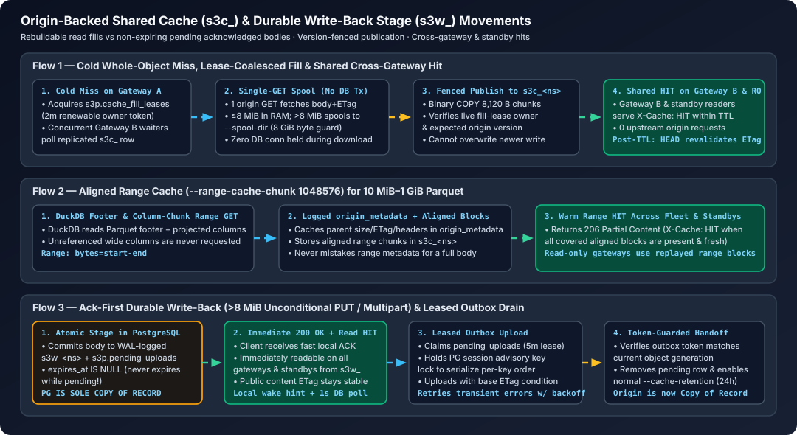

# Share object bytes without confusing freshness or authority

[Guide index](index.md) · Before: [analytics](analytics.md) · Next: [jobs](jobs.md)

**Goal:** remove repeated origin byte transfers across workers while keeping the
copy of record and allowed staleness explicit. pgvs3 is an object-byte cache and
durable write stage, not an automatic query-result cache or refresh engine.
[Research basis](sources.md#caches-are-not-interchangeable).



## Select the contract before a TTL

| Workload | Start with | Do not assume |
| --- | --- | --- |
| Immutable Parquet, repeatedly queried | Versioned keys; shared whole/range cache | A cache hit avoids DuckDB decoding or aggregation. |
| Mutable origin key | Explicit validation TTL within your stale budget | Direct origin changes invalidate PostgreSQL immediately. |
| Latency-sensitive large writes | Durable write-back only if readers use pgvs3 until drain | ACK means origin copy exists or an asynchronous standby can be promoted losslessly. |
| Origin-only downstream readers | Synchronous writes, or gate discovery on verified drain | Publishing a manifest last makes asynchronously staged data atomic at the origin. |
| Application result caching via RESP | Application-owned versioned key + TTL/invalidation | pgvs3 knows which SQL rows make a result stale. |

Prefer immutable dataset keys. For a hot set that fits only partly in PostgreSQL,
measure selective ranges before filling entire GiB objects. Fills consume logged
PostgreSQL bytes, indexes, WAL and replay capacity; they are not free reads.

## Reproduce a cross-gateway hit and a stale read

Use a **disposable S3-compatible origin** on `127.0.0.1:18014` and a writable
pgvs3 gateway on `:8014`. Both are private. The origin must support versioned
conditional mutations for production write use. `just guides` supplies an
independent PostgreSQL-backed S3 origin, two gateways and an instrumented proxy;
it does not need cloud credentials.

For this local demo, set `PGVS3_ORIGIN_ENDPOINT=http://127.0.0.1:18014` and create
only the named test object:

<!-- verify:cache-origin-seed -->
```sh
curl -fsS -X PUT "$PGVS3_ORIGIN_ENDPOINT/upstream"
curl -fsS -X PUT --data-binary 'version-one' \
  "$PGVS3_ORIGIN_ENDPOINT/upstream/guide-edge/version.txt"
```

Save as `origin.json` (real origin credentials are outbound secrets, unlike dummy
credentials sent by clients to pgvs3):

<!-- verify:cache-origin-config -->
```json
{
  "type": "s3",
  "config": {
    "bucket": "upstream",
    "endpoint": "http://127.0.0.1:18014",
    "access_key": "test",
    "secret_key": "test",
    "bucket_lookup_type": "path"
  }
}
```

Attach it to a dedicated bucket/cache namespace; this also creates the per-bucket
catalog row. The long TTL makes the stale case observable, not a recommendation
for mutable production keys:

<!-- verify:cache-origin-attach -->
```sh
pgvs3 origin --url "$PGVS3_URL" --bucket guide-edge \
  --cache-namespace guide-origin --cache-ttl 1h \
  --range-cache-chunk 1048576 set origin.json
```

Allow up to the bounded one-second configuration refresh. Read once on A, then
run the **same command on B** by setting `PGVS3_ENDPOINT` to its address:

<!-- verify:cache-read -->
```sh
curl -fsS -D - "$PGVS3_ENDPOINT/guide-edge/version.txt"
```

**Expected:** `version-one`; the warmed B request has `X-Cache: HIT` and causes
no origin GET/HEAD. HTTP headers alone are not request-count proof: the harness
counts origin requests independently and disables DuckDB client file/metadata
caches for the Parquet shared-hit checks.

Change the object **directly at the origin**, not through pgvs3:

<!-- verify:cache-external-change -->
```sh
curl -fsS -X PUT --data-binary 'version-two' \
  "$PGVS3_ORIGIN_ENDPOINT/upstream/guide-edge/version.txt"
```

The warmed cache still returns `version-one` within its TTL. For the demo,
switch to validation on every request:

<!-- verify:cache-revalidate -->
```sh
pgvs3 origin --url "$PGVS3_URL" --bucket guide-edge \
  --cache-namespace guide-origin --cache-ttl 0s \
  --range-cache-chunk 1048576 set origin.json
```

After configuration discovery, the next read returns `version-two`; it now
requires origin metadata I/O even when the body has not changed. Zero TTL is
not zero retention or free strict consistency across systems/replicas.
Restore your saved origin configuration to undo the experiment. Do not clear
the origin on a live bucket as an invalidation trick: that changes routing and
authority, not merely freshness.

## Range size and fill pressure

Large (>8 MiB) cold ranges pass through unless range caching is enabled. A
1 MiB aligned chunk is a **candidate**: it can help nearby column/footer reads
but overfetch isolated tiny ranges. Smaller chunks trade overfetch for more
rows/requests; larger ones can evict useful working set. Measure:

- origin requests **and bytes**, time to first byte and full query p95/p99;
- full-object versus selective queries, 10/100/1,024 MiB files and concurrency;
- warm B/standby reads with client caches off, not just a repeated query in A;
- PostgreSQL relation/WAL growth, pool waits and OLTP latency during cold fills.

Shared lease ownership coalesces cold fills but has a bounded waiter timeout and
pass-through fallback. It is not a promise of exactly one origin request through
every failure. Standby gateways consume replayed hits but never fill; misses
can still load the origin. Readiness does not mean a dataset is warm or fresh.

## Acknowledgement is not drain throughput

By default, unconditional PUT/COPY above 8 MiB and unconditional multipart
completion at any size commit the body and outbox in PostgreSQL before ACK.
Small/conditional writes are synchronous. Pending bodies have **no expiry**;
committed idle retention starts after handoff. Test the large path by making the
origin unavailable for writes, uploading a Parquet file, reading it through B,
then restoring the origin and verifying identical bytes there. `just analytics`
and the guide gate exercise this exact sequence.

Observe both sides of the handoff:

<!-- verify:pending-diagnostics -->
```sql
SELECT namespace, count(*) AS rows, coalesce(sum(size), 0) AS bytes,
       count(*) FILTER (WHERE dead) AS dead,
       max(now() - created_at) AS oldest
FROM s3p.pending_uploads
GROUP BY namespace;
```

`pgvs3 pending --url "$PGVS3_URL" list` adds attempt/error details. Size backlog
headroom as **ingress bytes/sec × credible outage duration**, plus live cache,
unpublished/retired files, physical overhead and WAL. For example, 50 MiB/s for
20 minutes is about **58.6 GiB of payload alone**. This is arithmetic, not a
measured storage multiplier. If drain throughput cannot exceed sustained ingress,
the backlog will never catch up. Throttle writers before disk exhaustion.

On origin precondition conflict, do not assume the pending version won; reconcile
the origin/application generation. Dead rows need repair and explicit retry, not
silent deletion. Never truncate `s3w_`, delete pending bodies, reset tokens or
shorten their expiry to reclaim space. A cache flush is not recovery and cannot
discard acknowledged data.

## Outage and cleanup rules

- Warm entries inside TTL can be served without origin I/O. Expired entries and
  misses can require the origin; pgvs3 is not a general stale-while-revalidate or
  serve-stale-on-error policy engine. Test your desired outage behavior.
- Write-through DELETE leaves a 30-minute tombstone. Direct origin recreation
  may stay hidden until it expires; recreation through pgvs3 replaces it.
- In `s3c_`, origin fills are rebuildable but standalone RESP values are not.
  Reserve distinct namespaces for distinct ownership/retention policies.
- Scratch spools are temporary, with a per-process payload budget. Keep disk
  headroom for logs/overhead as well; failed byte admission remains fail-fast.
- Use [owned-data cleanup](observe-recover.md#safe-demo-cleanup) only after pending
  work is drained and the test origin is no longer serving readers. Never turn a
  pending namespace into a “disposable cache” by renaming it.
